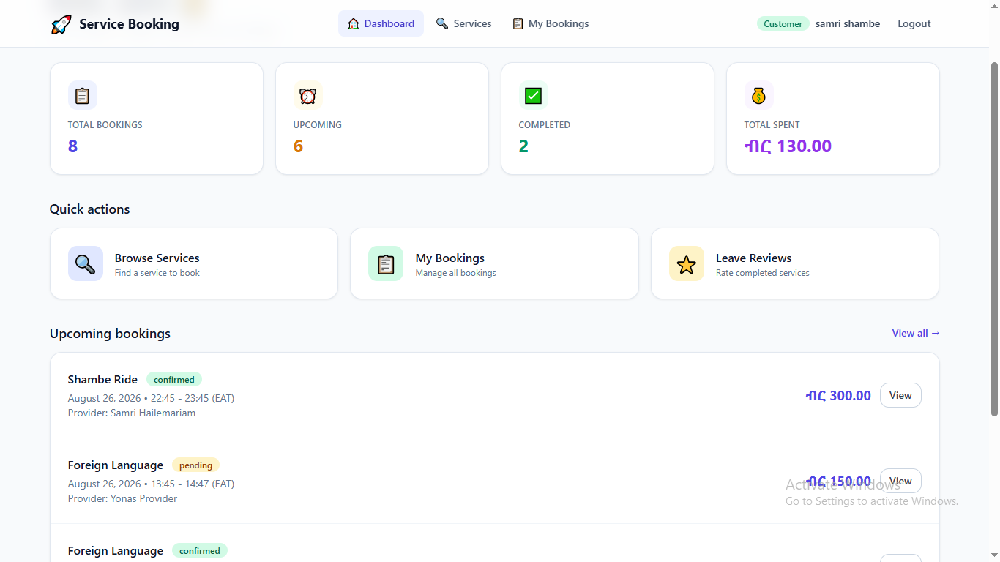
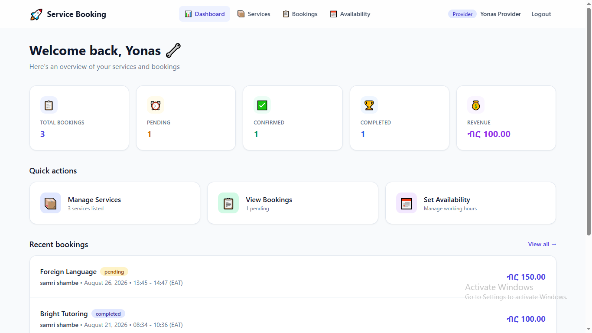
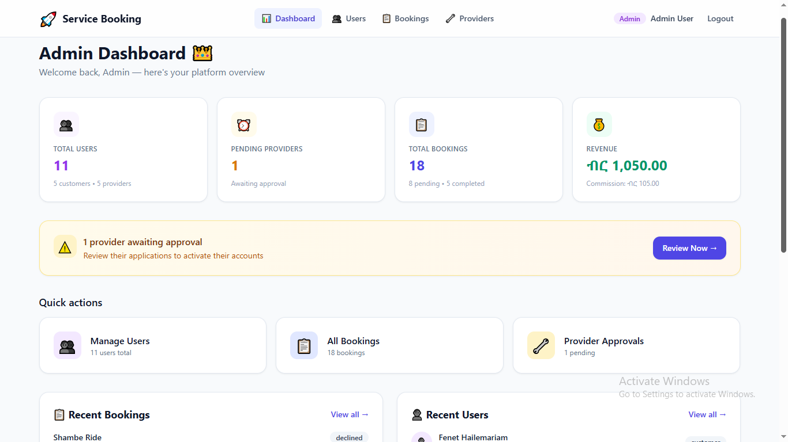
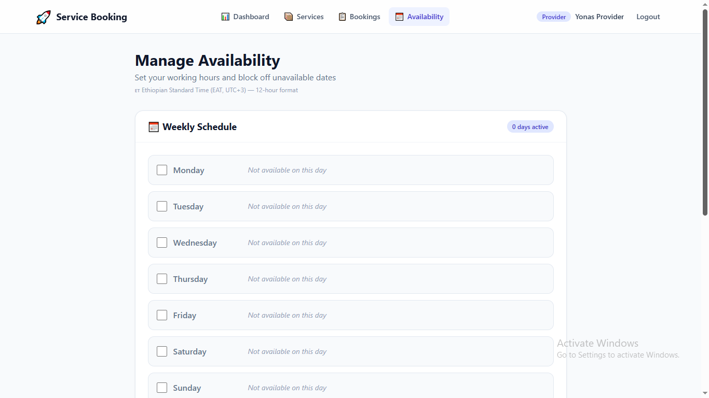
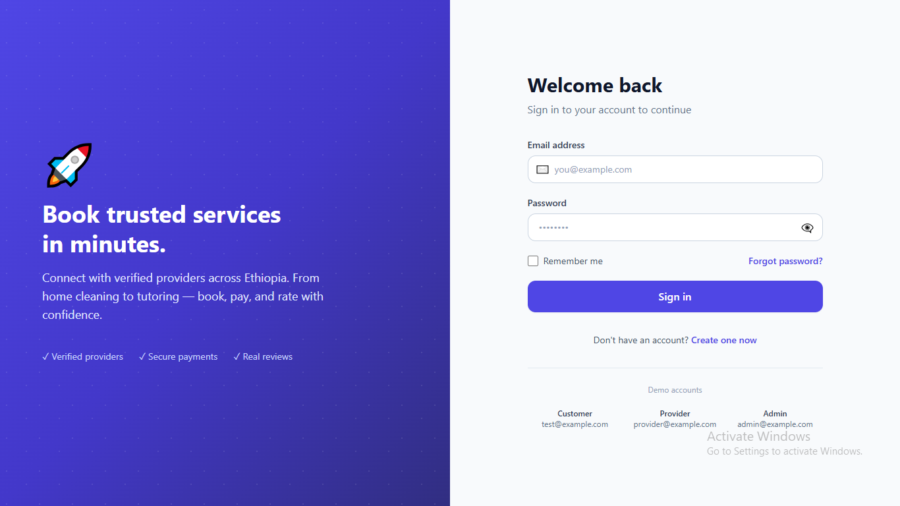
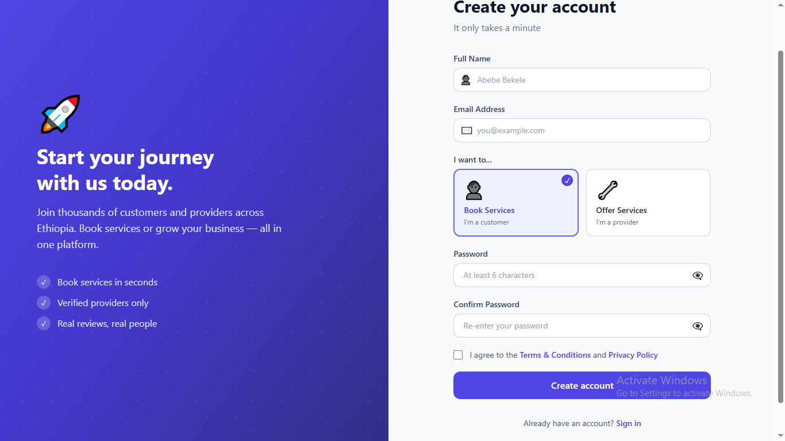
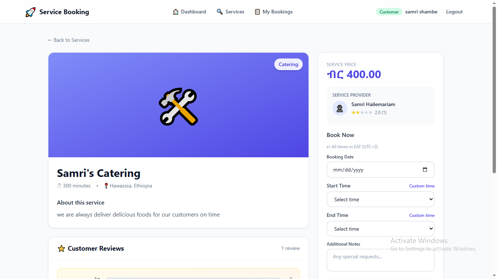
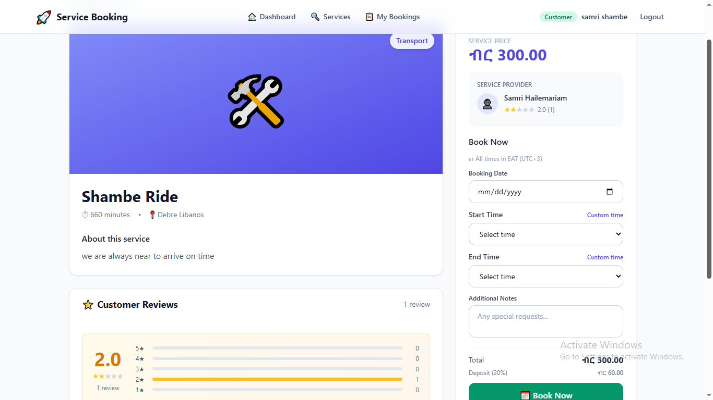

# Service Booking Platform
### A Multi-Vendor Marketplace Built for Ethiopia

---

**Developer:** [Samrawit Hailemariam]
**Role:** Full-Stack Developer
**Timeline:** [ August – October 2026]
**Type:** Personal Project
**Status:** Live in Production

**Live Demo:** [Vercel URL]
**Source Code:** [GitHub URL]
**Backend API:** [Render URL]

---

## 1. Project Overview

Service Booking Platform is a full-stack web application that connects customers with local service providers across Ethiopia. The platform supports three distinct user roles — Customers, Providers, and Admins — each with a dedicated dashboard and role-specific capabilities.

The system handles the complete booking lifecycle: service discovery → booking creation → provider acceptance → service completion → customer rating. It is fully localized for the Ethiopian market with Ethiopian Birr (ETB) currency and East Africa Time (EAT).

---

## 2. The Problem

Finding trusted local service providers in Ethiopia is difficult:

- **No centralized directory** — Providers rely on word-of-mouth
- **No quality verification** — Customers can't verify provider credentials
- **No transparency** — Cash-only transactions with no records
- **No accountability** — No reviews or ratings to guide decisions
- **Language/time barriers** — Existing platforms don't match local expectations

---

## 3. The Solution

A web-based platform that:

- **Verifies** providers through admin approval
- **Connects** customers with providers via searchable service listings
- **Manages** bookings with real-time availability checking
- **Ensures** accountability through ratings and reviews
- **Localizes** everything for Ethiopian users (ETB, EAT, 12-hour time)

---

## 4. My Role & Responsibilities

As the sole developer, I was responsible for:

| **Area** | **Deliverables** |
|----------|------------------|
| Database Design | 4 Mongoose schemas with relationships & indexes |
| Backend Development | 25+ REST API endpoints with JWT authentication |
| Frontend Development | 18+ React components with Tailwind CSS |
| DevOps | Deployment to Render + Vercel + MongoDB Atlas |
| Localization | Ethiopian Birr, East Africa Time, 12-hour format |
| Email System | Automated notifications for booking events |

---

## 5. Tech Stack

**Backend**
- Node.js + Express.js
- MongoDB + Mongoose ODM
- JSON Web Tokens (JWT) for auth
- bcryptjs for password hashing
- Nodemailer for emails

**Frontend**
- React 19 + Vite
- Tailwind CSS
- React Router v7
- Axios

**Infrastructure**
- MongoDB Atlas (cloud database)
- Render (backend hosting)
- Vercel (frontend hosting)
- GitHub (version control)

---

## 6. Key Features


### 👤 Customer Features



- Browse and search services by category
- View provider ratings and reviews
- Book services with Ethiopian 12-hour time picker
- Track bookings (pending → confirmed → completed)
- Cancel pending bookings
- Rate and review completed services

### 🔧 Provider Features



- Create and manage service listings
- View customer booking requests
- Accept, decline, or complete bookings
- Set weekly availability and block specific dates
- Track earnings in Ethiopian Birr (ETB)

### 👑 Admin Features



- Approve or reject provider applications
- View all users, bookings, and revenue
- Manage platform-wide analytics
- Monitor commission (10% of completed bookings)

### 📅 Availability Management



- Weekly schedule (Monday–Sunday)
- Custom working hours per day
- Block specific dates (holidays, time off)
- 12-hour Ethiopian time format

### 🇪🇹 Localization

- Ethiopian Birr (ETB) currency formatting: `Br 1,500.00`
- East Africa Time (EAT, UTC+3)
- 12-hour AM/PM time format
- English UI (Amharic planned)
## 7. Technical Challenges & Solutions

### Challenge 1: Preventing Double-Bookings

**Problem:** Two customers could book the same provider at overlapping times.

**Solution:** Multi-layer availability check:

```javascript
// 1. Check if date is blocked by provider
const isBlocked = provider.providerDetails?.blockedDates?.some(
  b => new Date(b.date).toDateString() === dateObj.toDateString()
);

// 2. Check if day is available in weekly schedule
const daySchedule = availability.find(
  a => a.day === dayName && a.isAvailable
);

// 3. Verify time is within working hours
if (bookingStart < scheduleStart || bookingEnd > scheduleEnd) {
  return res.status(400).json({ message: 'Outside working hours' });
}

// 4. Check for time overlap with existing bookings
const existingBooking = await Booking.findOne({
  providerId,
  bookingDate: { $gte: startOfDay, $lte: endOfDay },
  status: { $in: ['pending', 'confirmed'] }
});
Result: Zero double-bookings in production.

Challenge 2: Ethiopian Locale Support
Problem: Default $ currency and 24-hour time don't fit Ethiopian users.

Solution: Custom locale.js utility:

javascript
export const formatCurrency = (amount) => {
  return new Intl.NumberFormat('am-ET', {
    style: 'currency',
    currency: 'ETB',
    minimumFractionDigits: 2
  }).format(amount);
};

export const to12Hour = (time) => {
  const [hours, minutes] = time.split(':');
  let h = parseInt(hours);
  const ampm = h >= 12 ? 'PM' : 'AM';
  h = h % 12 || 12;
  return `${String(h).padStart(2, '0')}:${minutes} ${ampm}`;
};
Result: All prices display as Br 1,500.00, all times as 10:00 AM.

Challenge 3: Role-Based Access Control
Problem: Three user types need different permissions on the same API.

Solution: JWT middleware with role authorization:

javascript
exports.authorise = (...roles) => {
  return (req, res, next) => {
    if (!roles.includes(req.user.role)) {
      return res.status(403).json({
        success: false,
        message: `Role '${req.user.role}' is not permitted`
      });
    }
    next();
  };
};

// Usage
router.post('/services',
  protect,
  authorise('provider', 'admin'),
  createService
);
Result: Clean, reusable permission system across 25+ endpoints.

Challenge 4: Email Notifications
Problem: Users needed real-time updates without checking the platform.

Solution: Nodemailer integration with 5 email types:

Event	Recipient	Template
Registration	New user	Welcome email
New booking	Provider	Booking request
Booking confirmed	Customer	Confirmation
Service completed	Customer	Completion + rate prompt
Booking cancelled	Both	Cancellation notice
Result: Professional automated communication.

8. What I Learned
Technical Skills
Building secure REST APIs with JWT

Designing normalized MongoDB schemas with indexes

Managing complex React state across 3 dashboards

Deploying full-stack apps to production

Debugging production issues (CORS, env vars, timezones)

Soft Skills
Independent problem-solving over 2 months

Reading API documentation effectively

Managing scope creep

Persisting through hundreds of debug cycles

Business Understanding
How service marketplaces create value

The importance of trust (verification, reviews)

Why localization matters for adoption

9. Future Roadmap
💳 Payment integration — Chapa (Ethiopian gateway)

🌍 Amharic language — Full UI translation

📅 Ethiopian calendar — Convert dates to Ethiopian format

📱 Mobile app — React Native

⭐ Public profiles — Provider profile pages

🔔 Push notifications — Real-time updates

10. Metrics
Metric	Value
Lines of Code	~5,000+
API Endpoints	25+
React Components	18+
Database Collections	4
User Roles	3
Project Duration	2 months
Total Deployment Cost	$0 (all free tiers)

 📸 Full Screenshot Gallery

 Login Page


 Register Page


 Customer Dashboard


 Service Listings


 Service Details with Reviews


 Provider Dashboard


 Admin Dashboard


 Availability Manager


See screenshots/ folder for all UI captures.

🔗 Links
Live Demo: [URL]

Source Code: [GitHub]

Backend API: [Render]

LinkedIn: [ LinkedIn]